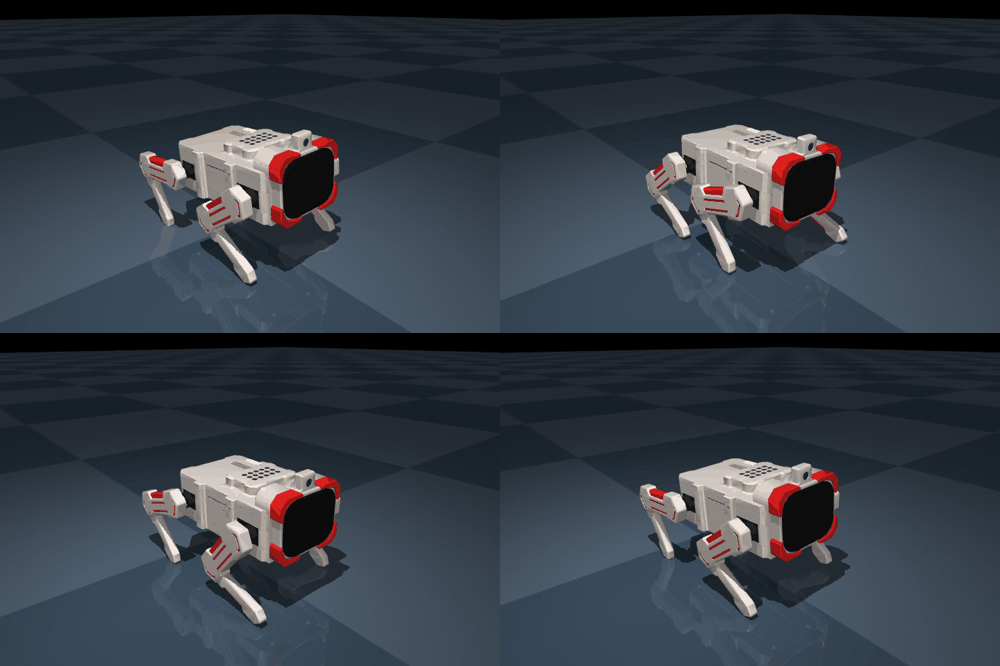

<div align="center">

<p><strong>DESKTOP ROBOT · OPEN DEVELOPMENT</strong></p>

# 四轴机器狗 T1

**从一条舵机指令，到四条腿的协同运动。**

ESP32-S3 × STM32F103RB · TTL 角度反馈 · 网页示教 · MuJoCo 仿真

[快速开始](#快速开始) · [项目导航](#项目导航) · [仿真与训练](#仿真与训练) · [硬件资料](原理图/README.md) · [English](README.en.md)



<p><sub>前进步态的物理仿真画面 · <a href="docs/images/t1-gait-preview.gif">查看动态演示</a></sub></p>

</div>

---

T1 是一台四轴桌面机器狗。ESP32-S3 负责联网、摄像头、音频与屏幕交互，STM32F103RB 负责四路 TTL 舵机和电源管理。这个仓库收录固件、网页工作台和硬件资料，并展示基于实际 CAD 几何构建的 MuJoCo 仿真与步态优化进展。仿真源码正在本地开发，待整理后上传。

你可以用网页控制单腿、读取真实角度，释放扭矩后手动摆腿记录动作，也可以在仿真里观察四腿运动、优化步态并回放验证。

## 可以做什么

| 方向 | 已有能力 |
| :--- | :--- |
| 舵机控制 | 四路独立 TTL 通信、0–180° 目标角度、角度回读、五档手动速度、到位保持 |
| 动作示教 | 释放扭矩后手动摆腿，记录和编辑动作帧，导入、导出动作，四腿回中 |
| 网页调试 | USB / Wi-Fi 连接、实时四腿模型、摄像头、音频、电源、总线与日志页面 |
| 屏幕交互 | 横屏显示、动态表情、屏幕触摸与头部触摸反馈 |
| 电源管理 | 充电档位保存、充电呼吸灯与充满指示 |
| 仿真训练 | 自由机身与地面接触、真实角度只读映射、周期步态优化、物理回放与指标验证 |

## 项目导航

| 模块 | 入口 | 说明 |
| :--- | :--- | :--- |
| ESP32 调试固件 | [ESP32-IDF-Debug](ESP32-IDF-Debug/README.md) | 联网、串口桥接、摄像头、音频、屏幕与触摸 |
| 小智语音应用 | [ESP32-IDF-Xiaozhi](ESP32-IDF-Xiaozhi/README-ROBOT.md) | 小智语音固件与 V0.24 板卡适配，独立于调试版 |
| STM32 标准库固件 | [STM32-LSP-Debug](STM32-LSP-Debug/README.md) | TTL 舵机、动作示教、快速回读与电源管理；目录沿用 LSP 命名，实际使用 SPL |
| STM32 HAL 工程 | [STM32-HAL-Debug](STM32-HAL-Debug/README.md) | 预留目录，尚无该主板的有效 HAL 实现 |
| 网页工作台 | [HTML-WorkBench](HTML-WorkBench/README.md) | 本地调试终端与用户网页 |
| 仿真与训练 | [MuJoCo 开发进展](#仿真与训练) | 已完成本地前进步态仿真，模型、训练源码与复现环境待整理上传 |
| 器件资料 | [Datasheet](Datasheet/README.md) | 芯片手册、模块资料与舵机协议 |
| 硬件设计 | [原理图](原理图/README.md) | 原生 EDA 工程、V0.24 原理图导出、BOM 与网表 |

## 快速开始

### 01 · 打开本地调试台

需要 Python 3.10+。在仓库根目录打开终端：

```powershell
cd HTML-WorkBench/Debug-Terminal
python -m pip install -r requirements.txt
```

首次使用先按 [调试终端说明](HTML-WorkBench/Debug-Terminal/README.md#本地配对密钥) 配置本地配对密钥，再启动：

```powershell
python tools/launch_windows.py --mode serial
```

打开 **[本地调试台 · 8081](http://127.0.0.1:8081/)**。首次通过 USB 配网和配对后，设备可使用已保存的 Wi-Fi 配置自动连接；具体连接方式见模块说明。

### 02 · 打开用户网页

在仓库根目录另开终端，需要已安装 Node.js / npm：

```powershell
cd HTML-WorkBench/User-Web
npm start
```

打开 **[用户工作台 · 8093](http://127.0.0.1:8093/)**，查看模型、配色、装配与编舞界面。两套网页独立启动，公网模型预览与实物控制的连接方式见 [网页说明](HTML-WorkBench/README.md)。

[公网 Robot Studio](https://110.42.234.162/robot-studio/) 使用独立服务部署，推送 Gitee 不会自动更新该网站。

### 03 · 查看仿真演示

[查看前进步态动态演示](docs/images/t1-gait-preview.gif)。画面来自本地 MuJoCo 物理仿真；模型、训练程序和可复现环境将在整理后单独上传，当前仓库先提供展示素材与阶段结果。

## 仿真与训练

当前前进步态使用 **交叉熵法（CEM）优化周期步态参数**，在自由机身、重力和足地接触条件下验证。模型几何来自现有 CAD；质量、惯量、摩擦和舵机动力参数仍为估算。

| 20 秒仿真验收 | 结果 |
| :--- | ---: |
| 前进距离 | 约 0.780 m |
| 稳态平均速度 | 约 0.041 m/s |
| 最大侧偏 | 约 1.45 cm |
| 最大机身倾斜 | 约 3.74° |
| 倾倒 / 机身触地 | 未发生 |

这是低抬脚、短步幅的前进步态，仍有支撑足滑移，**尚未完成实机步态验证**。完整训练记录、对照实验与复现入口将随仿真模块一起整理发布。

后续计划：

- [x] 基于 CAD 的四轴模型与实时角度映射
- [x] 前进步态优化、物理回放与仿真验收
- [ ] 后退、左转、右转动作训练与独立验收
- [ ] 实测质量、重心、舵机响应与脚底摩擦，校准仿真参数
- [ ] 实机低速验证及动作部署流程

## 四腿与通道

方向以机器狗自身朝向为准。实物目标角度范围为 **0–180°**，回中为 **90°**。

| 舵机 | 腿部 | STM32 引脚 |
| :---: | :---: | :---: |
| 1 | 右后腿 | PB6 |
| 2 | 左后腿 | PB7 |
| 3 | 右前腿 | PB8 |
| 4 | 左前腿 | PB9 |

手动控制到位后保持扭矩；示教页的“四腿回中”确认到位后释放扭矩，便于继续手动摆腿。模型显示方向校正与实物原始角度、动作数据分别处理。

## 固件与使用说明

| 项目 | 当前源码基线 |
| :--- | :--- |
| ESP32 调试版 | `public-servo-speed-20261106-r17` · ESP-IDF 5.4.4 |
| STM32 标准库版 | `stm32f103rb-action-teach-20261106-r18` · Keil / ARM Compiler 5.06 |
| 小智语音版 | 上游 v2.1.0 · ESP-IDF 5.4.4 · 独立应用与分区布局 |

构建与烧录请使用各模块 README。另请留意：

- **固件下载版本**：`HTML-WorkBench/User-Web/dist/firmware/` 保留的是 2026-10-29 历史公共包，其中 STM32 为 PWM 测试版，不适用于当前 TTL 舵机。
- **STM32 设置区**：Flash 最后 2 KiB（`0x0801F800–0x0801FFFF`）保存设备设置，更新应用时需保留。无保存记录时名义充电电流默认 350 mA，板端上限 1850 mA；档位值不等同于实测电流。
- **设备私有配置**：Wi-Fi 密码、配对密钥、个人动作数据及 Flash / NVS 备份保留在本地，不随源码发布。ESP32 调试版与小智版切换时，按各自分区布局处理，并保留设备有效备份。

## 文档与许可

[目录整理说明](docs/layout.md) · [源码文件清单与 SHA-256](docs/source-manifest.json) · [软件验证记录](docs/validation-20261106.md) · [项目许可](LICENSE)

各子工程与第三方组件保留各自的许可证及声明。构建输出、环境目录、运行日志、缓存和本地私有配置不进入源码仓库。
