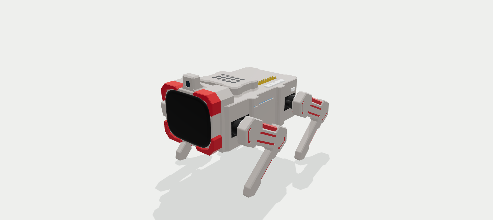
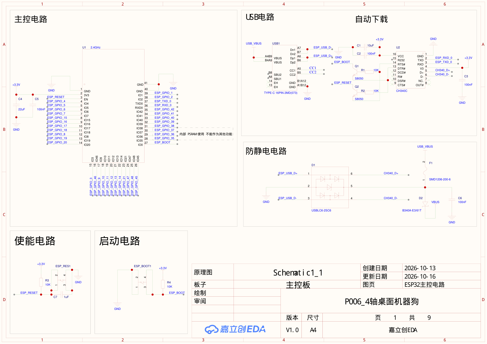
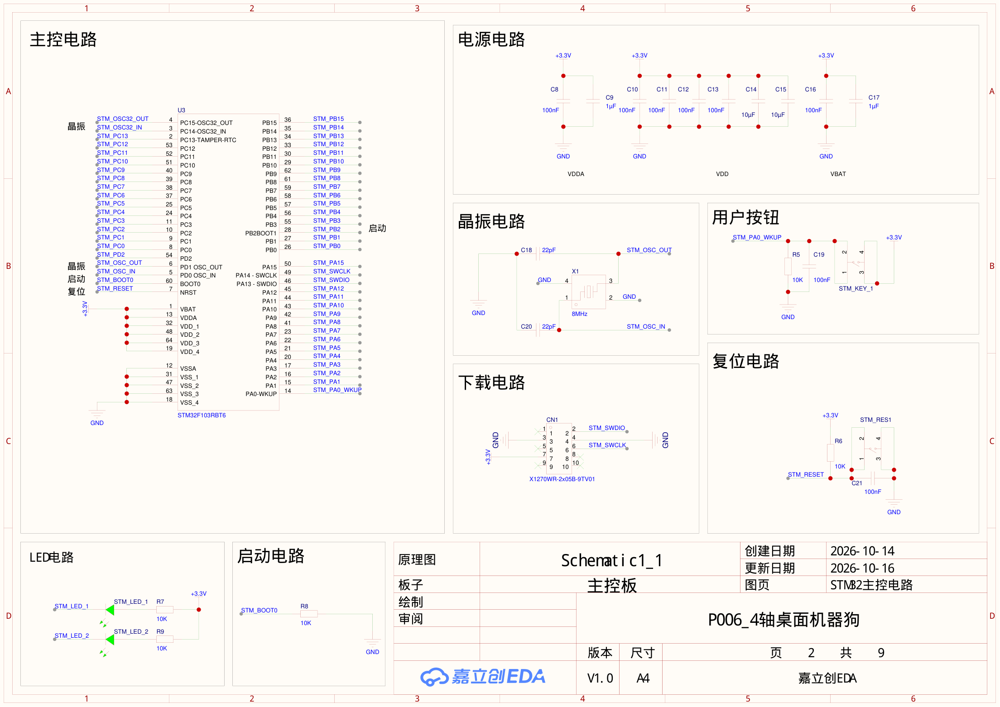
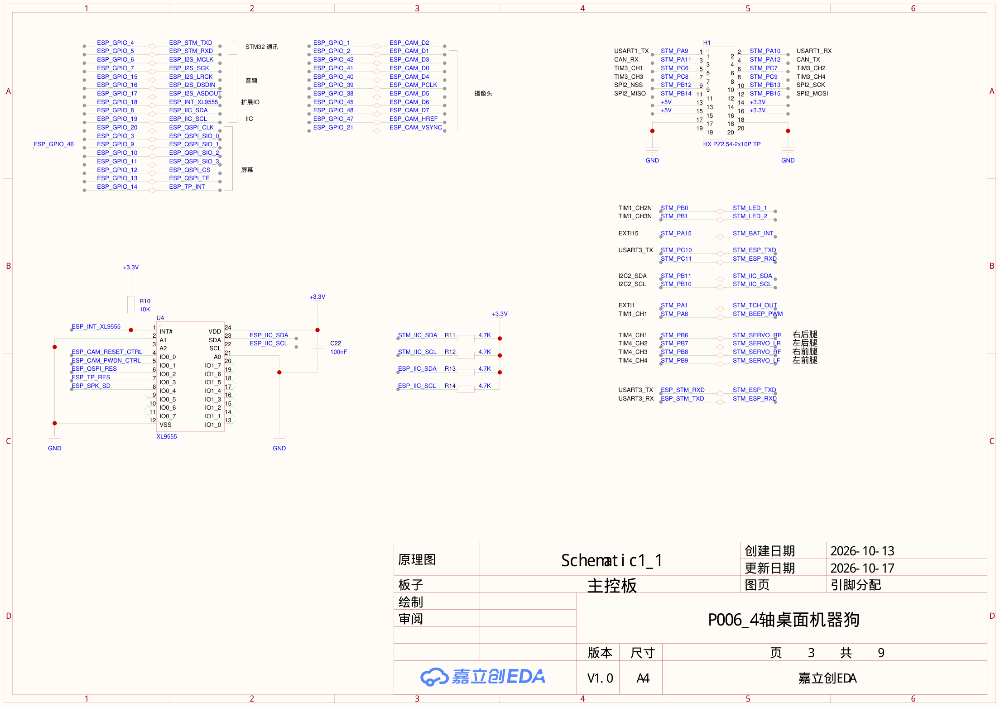
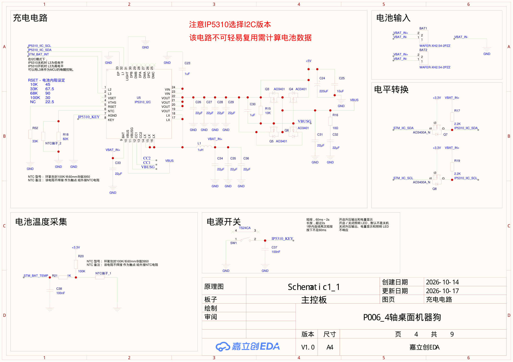
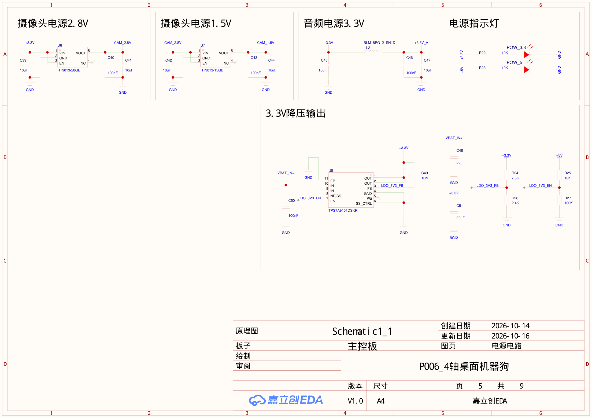
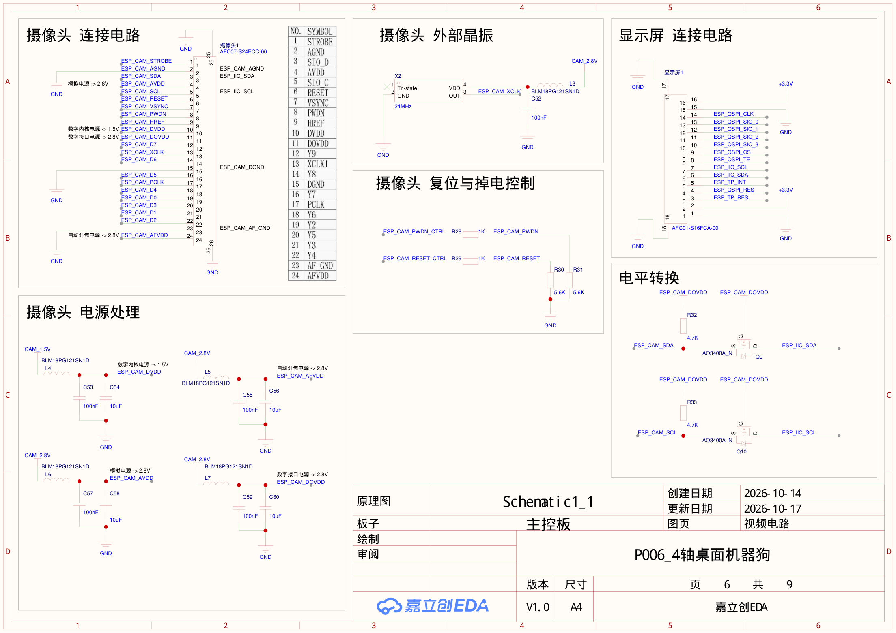
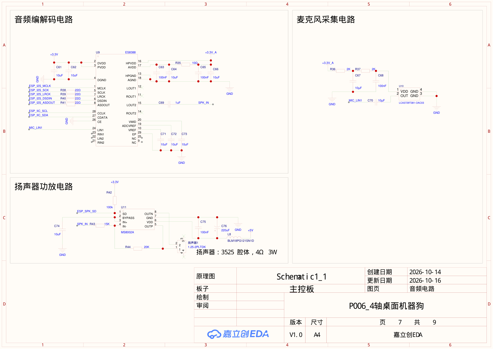
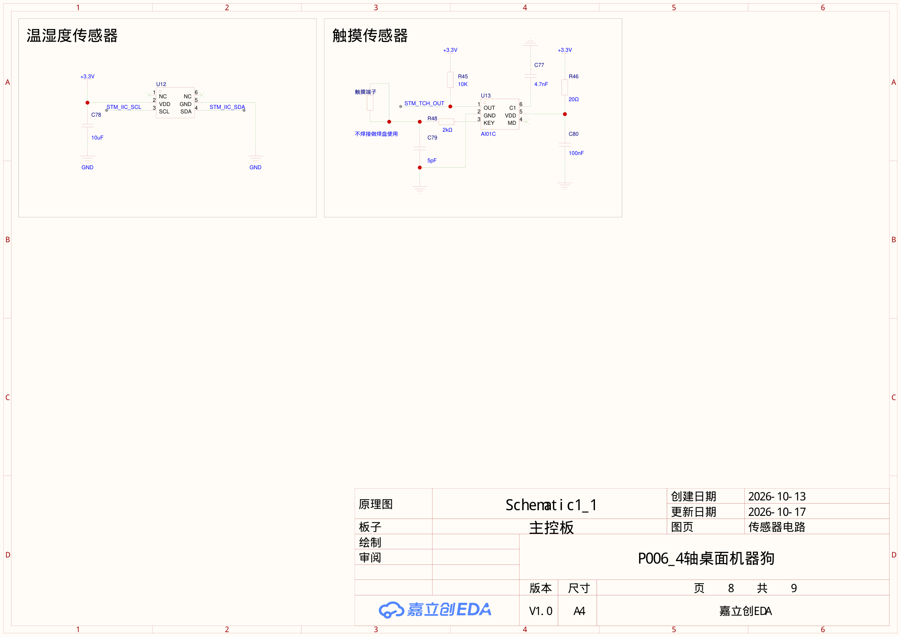
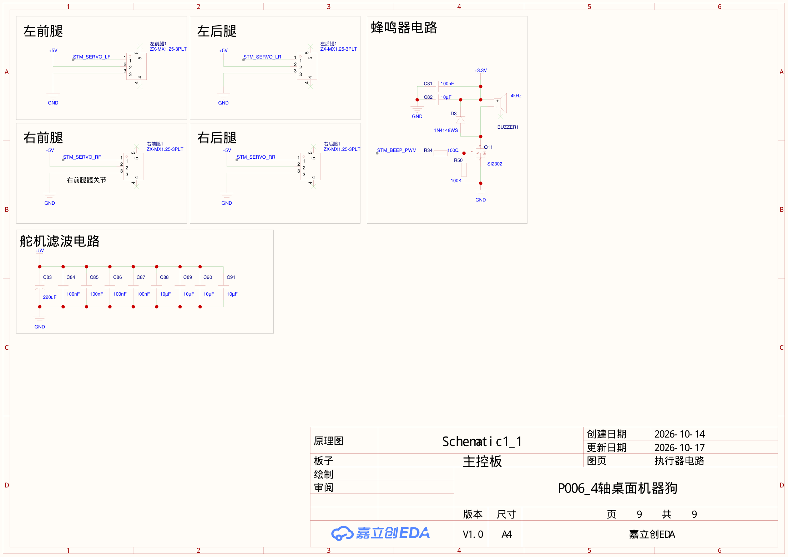

# T1 图片素材库

用于项目首页、介绍页和后续重新排版。PNG 可直接嵌入 Markdown；框架图、示意图和曲线另附 SVG 矢量版。点击预览可以打开原图。

[返回项目首页](../../README.md) · [图片来源与校验信息](media-index.json)

## 来源与使用说明

- Robot Studio 图片：由 `HTML-WorkBench/User-Web/dist/` 的网页原生导出，使用仓库自带的实际装配模型。公网入口当前需登录，本次使用本地副本渲染，没有取得或使用公网账号。
- 两套配色为网页设计效果，模型图片均为 CAD 渲染，不是实物照片。爆炸图为结构展示示意。
- 调试页截图来自本机工作台的只读查看，反映本地开发状态，可能含尚未发布的功能。未操作舵机或充电设置。
- MuJoCo 图片与曲线来自本地开发中的模型和已保存轨迹，动力参数为估算，不能代表实机性能。
- 原理图为仓库内已有 V0.24 PDF 的逐页预览；原设计和第三方声明保持原样。

## 推荐主视觉

## 文件框架

[PNG 原图](repository-map.png) · [SVG 矢量版](repository-map.svg)

## 全部素材索引

### Robot Studio 网页模型

| 图片 | 用途 | 尺寸 |
| :--- | :--- | :--- |
| [studio-original-isometric.png](studio-original-isometric.png) | 原色立体主视觉 | 2098 × 936 |
| [studio-original-front.png](studio-original-front.png) | 原色正面 | 2098 × 936 |
| [studio-original-side.png](studio-original-side.png) | 原色侧面 | 2098 × 936 |
| [studio-original-top.png](studio-original-top.png) | 原色俯视 | 2098 × 936 |
| [studio-exploded.png](studio-exploded.png) | 原装配结构爆炸图 | 2098 × 936 |
| [studio-color-moss.png](studio-color-moss.png) | 苔原配色概念 | 2098 × 936 |
| [studio-color-apricot.png](studio-color-apricot.png) | 奶油橘配色概念 | 2098 × 936 |
| [studio-workbench.png](studio-workbench.png) | Robot Studio 网页实览 | 2552 × 1227 |

### 文件框架与功能示意

| 图片 | 用途 | 尺寸 |
| :--- | :--- | :--- |
| [repository-map.png](repository-map.png) · [SVG](repository-map.svg) | 仓库文件框架 | 2310 × 1610 |
| [system-overview.png](system-overview.png) · [SVG](system-overview.svg) | 系统职责与通信概览 | 2310 × 1190 |
| [leg-channel-map.png](leg-channel-map.png) · [SVG](leg-channel-map.svg) | 四腿通道定位 | 2310 × 1190 |

### 本地调试网页

| 图片 | 用途 | 尺寸 |
| :--- | :--- | :--- |
| [workbench-actions.png](workbench-actions.png) | 动作调试与实时模型 | 2537 × 1267 |
| [workbench-servos.png](workbench-servos.png) | 四路 TTL 控制 | 2537 × 1267 |
| [workbench-teaching.png](workbench-teaching.png) | 手动示教与动作帧 | 2537 × 1267 |

### MuJoCo 模型视图

| 图片 | 用途 | 尺寸 |
| :--- | :--- | :--- |
| [robot-isometric.png](robot-isometric.png) | MuJoCo 立体视图 | 1440 × 1000 |
| [robot-front.png](robot-front.png) | MuJoCo 正面 | 1440 × 1000 |
| [robot-side.png](robot-side.png) | MuJoCo 侧面 | 1440 × 1000 |
| [robot-rear.png](robot-rear.png) | MuJoCo 背面 | 1440 × 1000 |
| [robot-top.png](robot-top.png) | MuJoCo 俯视 | 1440 × 1000 |

### 仿真与训练结果

| 图片 | 用途 | 尺寸 |
| :--- | :--- | :--- |
| [t1-gait-preview.png](t1-gait-preview.png) | 前进步态连续画面 | 1440 × 960 |
| [t1-gait-preview.gif](t1-gait-preview.gif) | 前进步态动态演示 | 720 × 480 |
| [training-displacement.png](training-displacement.png) · [SVG](training-displacement.svg) | 前进位移与侧偏 | 2158 × 900 |
| [training-joint-angles.png](training-joint-angles.png) · [SVG](training-joint-angles.svg) | 四腿实际仿真角度 | 2158 × 922 |
| [training-foot-contact.png](training-foot-contact.png) · [SVG](training-foot-contact.svg) | 仿真足地接触力 | 2158 × 1239 |

### 原理图文件索引

| 图片 | 用途 | 尺寸 |
| :--- | :--- | :--- |
| [schematic-01-esp32.png](schematic-01-esp32.png) | 第 1 页 · ESP32 | 2208 × 1562 |
| [schematic-02-stm32.png](schematic-02-stm32.png) | 第 2 页 · STM32 | 2208 × 1562 |
| [schematic-03-interfaces.png](schematic-03-interfaces.png) | 第 3 页 · 接口 | 2208 × 1562 |
| [schematic-04-charging.png](schematic-04-charging.png) | 第 4 页 · 充电与电池 | 2208 × 1562 |
| [schematic-05-regulators.png](schematic-05-regulators.png) | 第 5 页 · 稳压供电 | 2208 × 1562 |
| [schematic-06-camera.png](schematic-06-camera.png) | 第 6 页 · 摄像头 | 2208 × 1562 |
| [schematic-07-audio.png](schematic-07-audio.png) | 第 7 页 · 音频 | 2208 × 1562 |
| [schematic-08-sensors.png](schematic-08-sensors.png) | 第 8 页 · 传感器 | 2208 × 1562 |
| [schematic-09-servo-power.png](schematic-09-servo-power.png) | 第 9 页 · 执行器接口 | 2208 × 1562 |

## 原理图预览

逐页内容如下，完整原件见 [V0.24 归档目录](../../原理图/Exports/V0.24/)。

### 第 1 页 · ESP32

### 第 2 页 · STM32

### 第 3 页 · 接口

### 第 4 页 · 充电与电池

### 第 5 页 · 稳压供电

### 第 6 页 · 摄像头

### 第 7 页 · 音频

### 第 8 页 · 传感器

### 第 9 页 · 执行器接口

## 训练曲线来源

[20 秒仿真原始轨迹](source-data/gait-trace.csv) · [同次仿真验收结果](source-data/gait-evaluation.json)

角度图按 `90° + rad2deg(q)` 转换；位移图覆盖 20 秒，角度与接触力图展示前 6 秒。SVG 中保留文字对象；跨平台展示建议使用 PNG。
